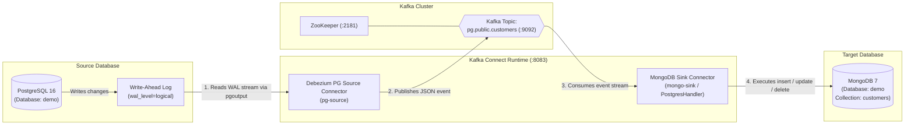
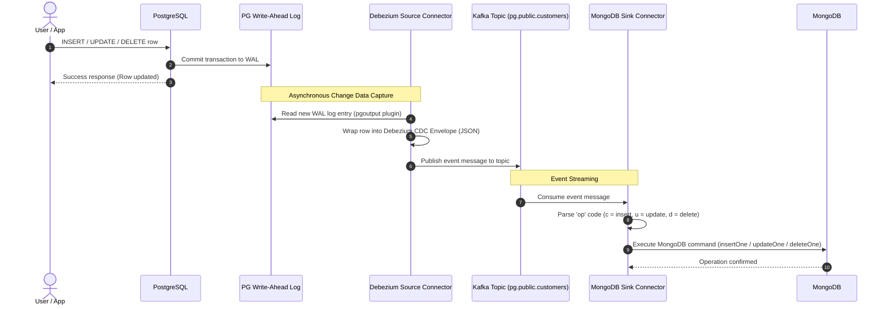
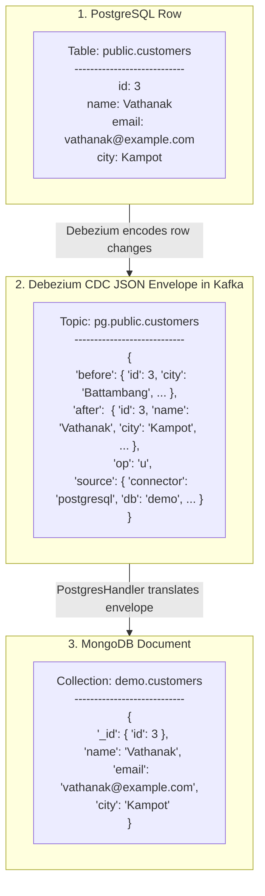
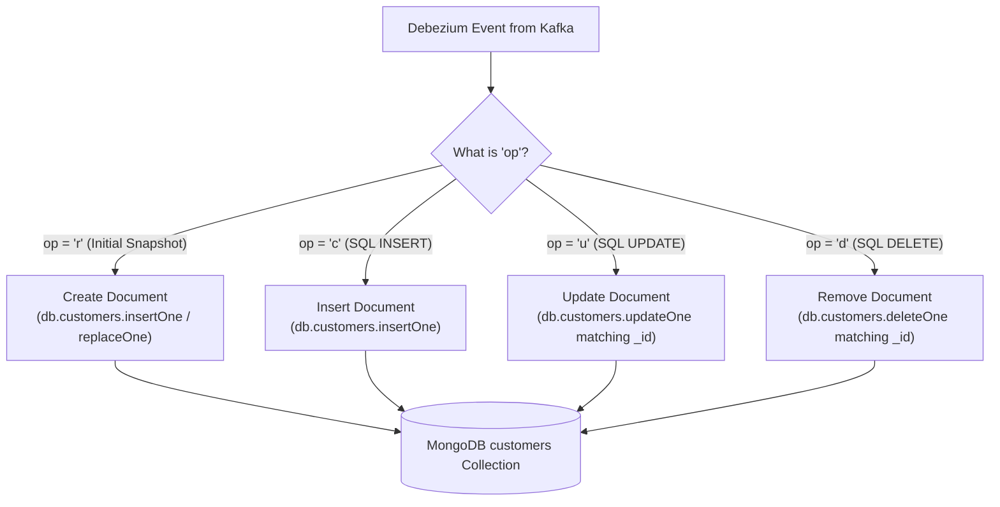

# Architecture & Data Flow Diagrams

This document visually explains how data flows in real-time from **PostgreSQL** to **MongoDB** using **Debezium**, **Apache Kafka**, and **Kafka Connect**.

---

## 1. High-Level Architecture Diagram

---

## 2. End-to-End Sequence Diagram

This sequence diagram illustrates what happens when an application or user performs an `INSERT`, `UPDATE`, or `DELETE` in PostgreSQL:

---

## 3. Data Transformation at Each Stage

This diagram shows how a row changes structure as it travels from PostgreSQL to MongoDB:

---

## 4. Operation Code (`op`) Decision Tree

When the **MongoDB Sink Connector** receives an event from Kafka, the built-in `PostgresHandler` decides what to do based on the `op` field:

---

## 5. Summary of Components & Ports

| Component | Container Name | Port | Description |
| :--- | :--- | :--- | :--- |
| **PostgreSQL** | `cdc-postgres-to-mongodb-postgres-1` | `5432` | Source database holding the `customers` table with `REPLICA IDENTITY FULL`. |
| **ZooKeeper** | `cdc-postgres-to-mongodb-zookeeper-1` | `2181` | Coordinates the Kafka broker cluster state. |
| **Kafka** | `cdc-postgres-to-mongodb-kafka-1` | `9092` | Durable distributed event log hosting the `pg.public.customers` topic. |
| **Kafka Connect** | `cdc-postgres-to-mongodb-connect-1` | `8083` | JVM runtime running Debezium PG Source & MongoDB Sink plugins. |
| **Kafka UI** | `cdc-postgres-to-mongodb-kafka-ui-1` | `8080` | Web UI for inspecting Kafka topics, CDC messages, and Kafka Connect tasks. |
| **MongoDB** | `cdc-postgres-to-mongodb-mongo-1` | `27017` | Target document database storing the replicated `customers` documents. |
